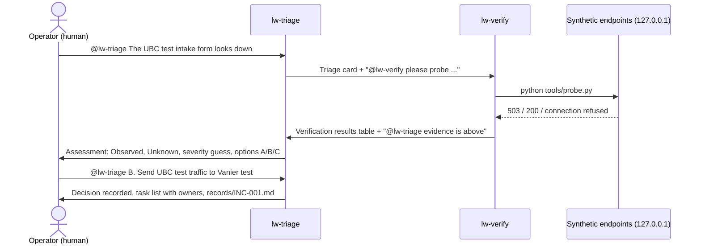

# Looseword Ops Room

**A human operator and two AI agents work through an intake outage together in one Switch room.**

A person reports that a test intake form is down. A triage agent frames the problem and
hands the checks to a verification agent. The verification agent probes real (local,
synthetic) endpoints and hands the evidence back. The triage agent writes an assessment
that keeps what was observed apart from what is unknown, and offers options. The person
decides, and the decision and next tasks land in the room and in a written incident record.

This is a hackathon prototype for **Flip the Switch** (November 4 to 7, 2026). Everything
it checks is synthetic and runs on `127.0.0.1`. It is not connected to the live
[Looseword](https://looseword.ca) site, its Google Forms, or any student data.

## Why Switch is essential here

Without Switch this would be one chatbot pretending to be two people. Switch makes it a team:

- **One shared room, real members.** Switch Console created `#looseword-ops-room` in Mattermost.
  Each agent joins as its own bot user, so the operator sees who said what.
- **Agent to agent handoffs.** lw-triage hands work to lw-verify by mentioning it, and
  lw-verify hands evidence back the same way. Switch routes each mention to the right agent's
  own Claude Code session. Agent addressing is set to "Me and my agents", so the agents can
  hand work to each other while nobody outside can drive them.
- **Separate jobs, separate machines' worth of context.** Each agent runs in its own working
  folder with its own brief. lw-triage cannot run the probe. lw-verify cannot recommend actions.
  The split is enforced by what each agent has, not by one prompt playing two roles.
- **The human stays in the loop.** Agents only act when addressed, and the decision is the
  operator's message in the room. The room history is the audit trail.

## What happens in a run



Choosing **C** (hold and re-check) sends lw-triage back to lw-verify for a fresh probe, so the
room shows a second handoff and, if the simulator was switched to `recovered`, the change.

## Connected agents

| Agent | Provider | Working folder | Job | Can it act on the endpoints? |
|---|---|---|---|---|
| `lw-triage` | Claude Code via Switch Console | [agents/lw-triage](agents/lw-triage/CLAUDE.md) | Frames the report, hands checks to lw-verify, writes the assessment, records the decision | No. It only writes `records/` |
| `lw-verify` | Claude Code via Switch Console | [agents/lw-verify](agents/lw-verify/CLAUDE.md) | Runs `tools/probe.py`, posts what it printed and what it does not show | Reads only, local hosts only |

The Switch Console's own helper, `switch-buddy-admin`, is not part of the workflow.

## Room setup

- **Room:** `looseword-ops-room`, created in Switch Console under **Your Rooms**, bridged to
  the local Mattermost that Console starts.
- **Members:** the operator plus `lw-triage` and `lw-verify`.
- **Room instructions** (shown to agents when they enter): "Synthetic incident drill. Flow:
  operator reports, lw-triage frames it and hands to lw-verify, lw-verify probes and hands
  back, operator decides. Only act when addressed."
- **Who can talk to each agent:** "Me and my agents (default)".
- **Agent settings:** Claude Code provider, run on this computer, auto mode on (the default),
  working directory set to the agent's folder in this repo.

Exact clicks are in [SETUP.md](SETUP.md).

## Prerequisites and costs

| Need | Version tested | Cost |
|---|---|---|
| Windows 11 (macOS and Linux builds of Switch Console exist but were not tested) | 10.0.26200 | none |
| [Switch Console](https://docs.switchagents.ai/switch-rooms/getting-started) | 0.40.1 (Windows x64, early access) | No price is listed for local use. Free in this setup |
| Docker Desktop (Console runs Mattermost in a container) | Engine 29.8.2, image `mattermost/mattermost-team-edition:11.9.0` | none |
| Claude Code, installed and signed in | 2.1.316 | Uses your Claude plan's usage. A full run is two short agent sessions. No API key needed |
| Python | 3.10 or newer (tested on 3.14.5). Standard library only, nothing to install | none |

## Run it

```bash
git clone https://github.com/V3sr/looseword-ops-room.git
cd looseword-ops-room
python -m unittest discover -s tests -v
python sim/intake_sim.py
```

Run the tests first, while no simulator is running: they start their own copy on ports 8701
and 8702, probe all three targets, check each outcome, then check recovery and that
non-local URLs are refused. If a simulator is already up they stop with "Port 8701 is already
in use". After that, leave `sim/intake_sim.py` running in its own terminal, follow
[SETUP.md](SETUP.md) once, then run the scenario with [DEMO.md](DEMO.md). The setup and demo
commands are written for PowerShell on Windows, which is what was tested.

## Synthetic targets

| Target | Address | Behaviour |
|---|---|---|
| `ubc-test` | `127.0.0.1:8701` | Waits 1.2 s, then HTTP 503 `form_backend_timeout`. With `--scenario recovered`, HTTP 200 |
| `vanier-test` | `127.0.0.1:8702` | HTTP 200 `accepting` |
| `orchard-test` | `127.0.0.1:8703` | Nothing listens, so connection refused |

Form IDs such as `SYN-UBC-TEST-01` are invented. No real form, student, receipt or identity
exists anywhere in this repo.

## Results from the recorded runs (November 5, 2026, local time)

| Run | What was exercised | What the room showed | Evidence |
|---|---|---|---|
| 1 | Report, triage, verify, assessment, decision B | 503 in 1250 ms, 200 in 2 ms, connection refused; decision and 5 owned tasks recorded | [screens](docs/evidence/run1-01-report-triage-verify.jpg), [assessment](docs/evidence/run1-02-assessment-decision.jpg), [record](docs/evidence/run1-INC-001.md) |
| 2 | Repeat report, decision C, second handoff, recovery | Same 503; after C, lw-verify re-probed and saw 200 in 54 ms; record updated | [report](docs/evidence/run2-01-repeat-report.jpg), [handoff](docs/evidence/run2-02-decision-c-handoff.jpg), [re-probe](docs/evidence/run2-03-recovered-reprobe.jpg), [record](docs/evidence/run2-INC-001-updated.md) |

| 3 | Separate report after the table fix | Table renders properly; lw-triage kept it under INC-001 instead of opening INC-002 | [screen](docs/evidence/run3-01-table-renders.jpg) |

Each hop took well under a minute. In runs 1 and 2 the probe table shows as raw `|` text in
the screenshots; the numbers are correct, and run 3 shows the fixed rendering. Two brief
fixes came out of these runs and have not been re-run yet: lw-triage added one small
unstated fact in run 1 ("One person saw it"), and it did not open a new incident number in
run 3. Full notes are in [docs/evidence/RUNS.md](docs/evidence/RUNS.md).

## Boundaries

- Synthetic only. `tools/probe.py` refuses any host other than `127.0.0.1` or `localhost`,
  and a test checks that.
- No production changes. The options A and B are recorded decisions, not actions. Nothing
  in this repo can change a form, a moderation setting or an account.
- Screenshots contain only the local operator account, the two bots and synthetic data.

## Limitations

- It is a prototype, not monitoring. Nothing runs on a schedule and nothing pages anyone.
- Agent wording varies run to run. The structure (headings, handoff mentions, record file)
  is held by each agent's brief, not by code.
- lw-verify can only see what the probe prints. It correctly says it cannot explain why
  `orchard-test` is down; a real version would need logs or a status page.
- Tested on one Windows machine with Switch Console 0.40.1.

## Repo layout

```
agents/lw-triage/CLAUDE.md   triage agent brief (its working folder)
agents/lw-verify/CLAUDE.md   verification agent brief (its working folder)
sim/intake_sim.py            synthetic intake endpoints
tools/probe.py               the only tool lw-verify uses
targets.json                 the three synthetic targets
tests/test_probe.py          end to end checks of sim + probe
SETUP.md                     one-time Switch Console setup
DEMO.md                      demo script for the video
docs/evidence/               screenshots and incident records from the recorded runs
```

Built during Flip the Switch, November 2026. Switch setup and the agent workflow were made
during the hackathon; the simulator and probe use only the Python standard library.
